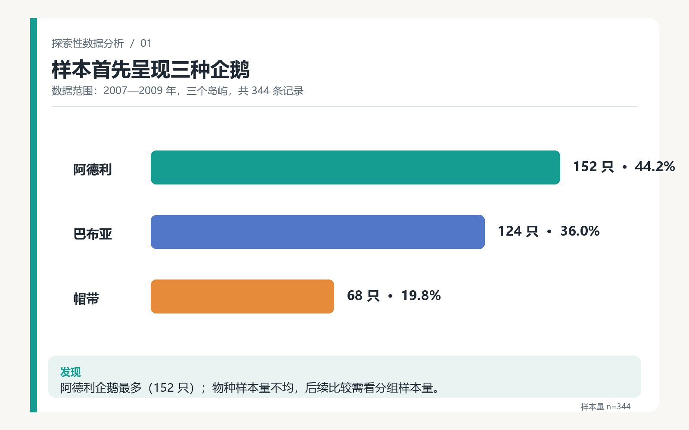
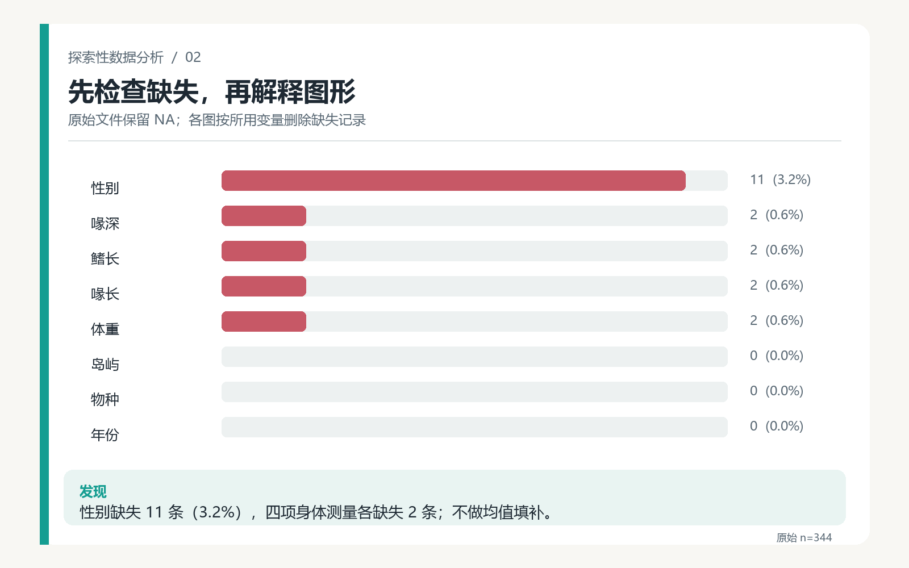
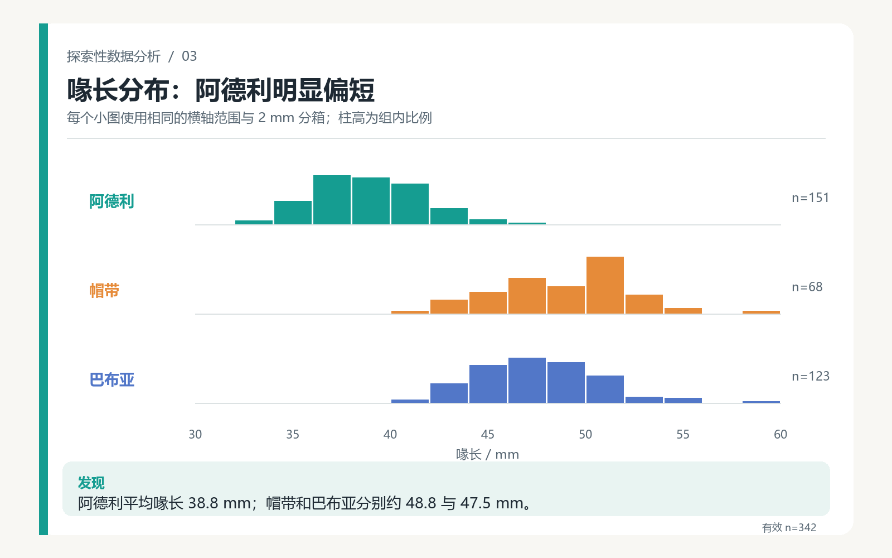
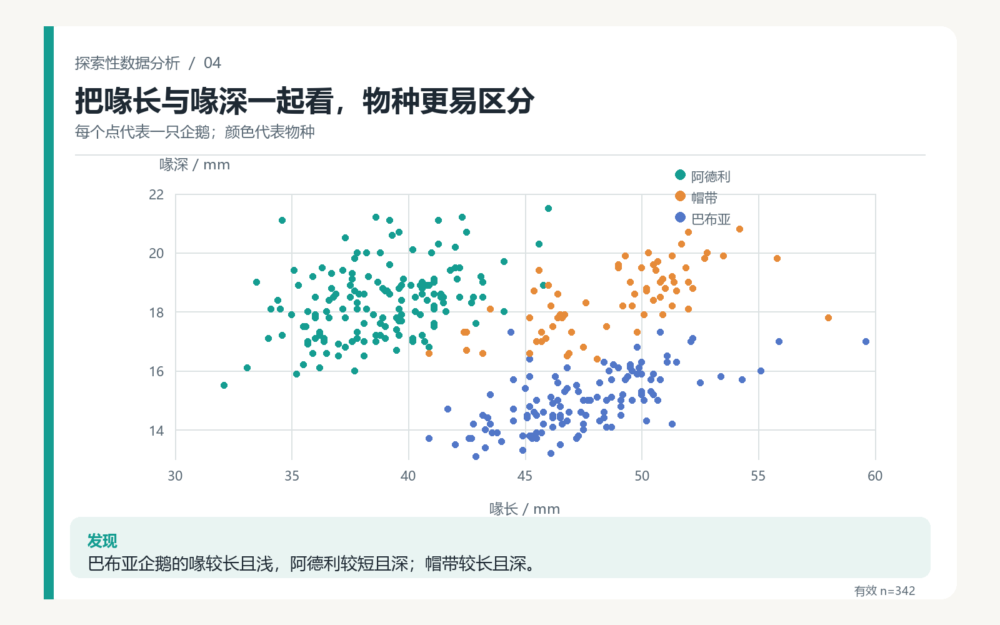
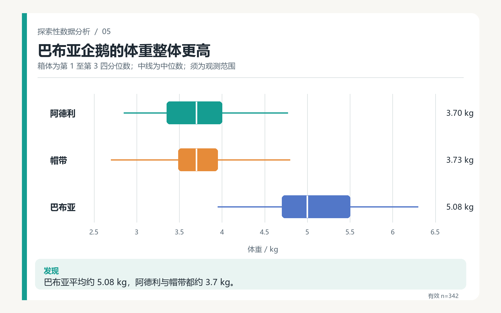
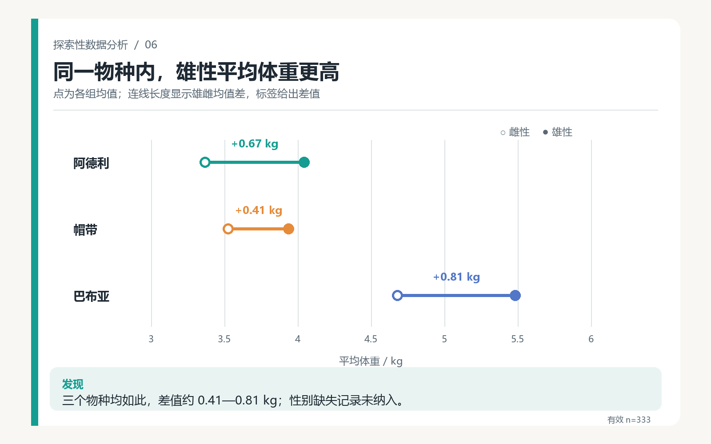
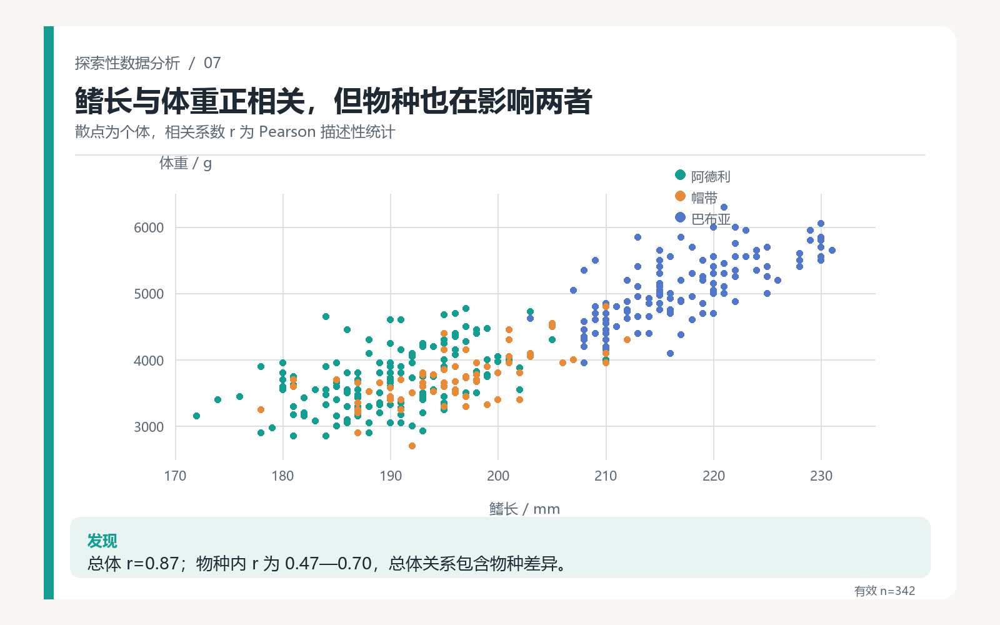
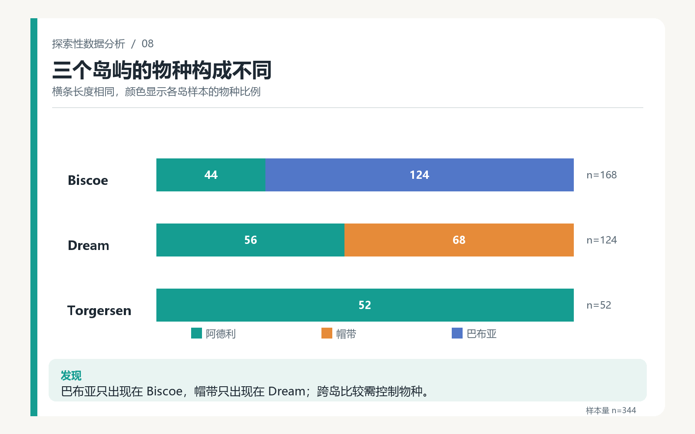
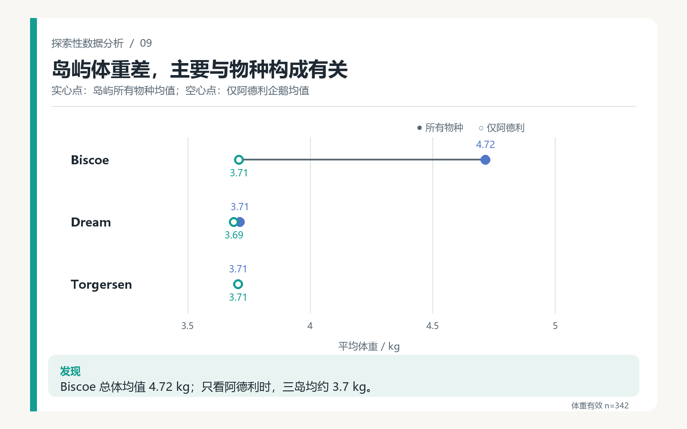
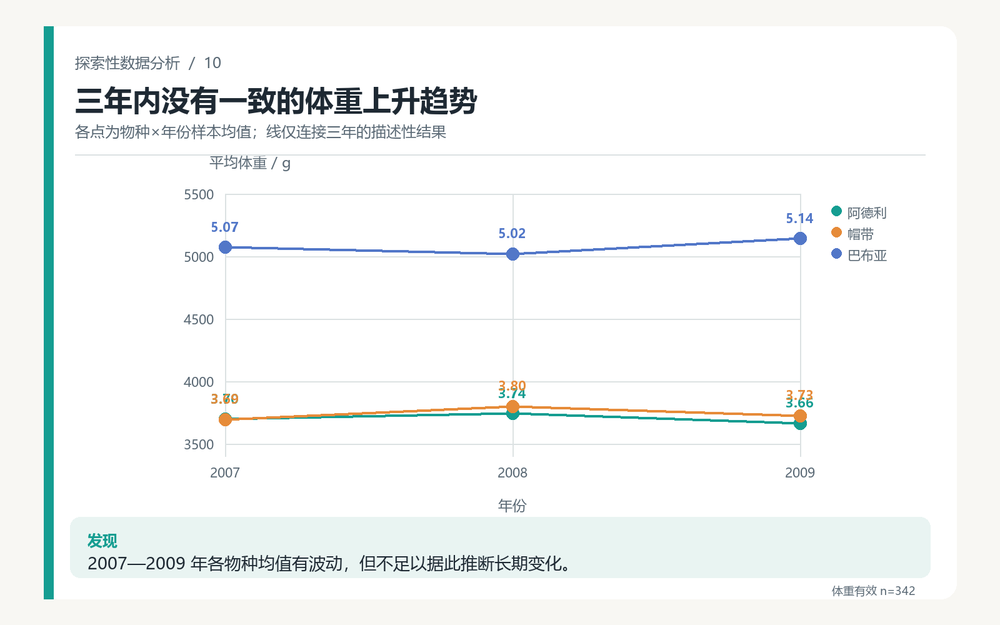

# Palmer 群岛企鹅：探索性数据分析报告

**研究范围：**2007—2009 年、3 个岛屿、3 种企鹅，共 344 条观测记录。  
**数据来源：**[palmerpenguins 官方公开数据](https://github.com/allisonhorst/palmerpenguins/blob/main/inst/extdata/penguins.csv)。  
**阅读方式：**按下文顺序阅读 10 张可视化；文字部分交代研究问题、处理方法和解释边界。

## 一、研究设计

本报告希望了解三种企鹅在身体形态和体重上的差异，并检查一些看似明显的关系是否受到物种或采样地点的影响。**在分析数据之前**，先提出以下三个问题：

1. 三种企鹅的身体形态有什么差异？哪些测量值有助于区分物种？
2. 鳍长与体重是否相关？这种关系在各物种内部仍然存在吗？
3. 同一物种内，雌雄企鹅的体重是否不同？

在初步探索后，又追加两个问题：**岛屿间的体重差是否受到物种构成影响？2007—2009 年各物种的体重均值是否呈现一致趋势？**

## 二、先了解样本与数据质量

### 图 1｜物种样本量

阿德利企鹅样本最多（152 只），帽带企鹅最少（68 只）。后续比较既看均值和分布，也注意各组样本量。

### 图 2｜缺失值检查

性别缺失 11 条；喙长、喙深、鳍长和体重各缺失 2 条。物种、岛屿和年份没有缺失。

### 数据处理方法

原始 CSV 有 **344 行、8 列**。分析保留原始文件，不对缺失值做均值填补；每张图只排除其所用变量缺失的记录，因此物种与岛屿构成图使用 344 条记录，单项身体测量图一般使用 342 条，性别与体重比较使用 333 条。图中标出各自的有效样本量。

体重原始单位为克（g）；为了便于阅读，部分均值标签换算成千克（kg）。探索顺序是先看样本与缺失，再比较单项分布和两个变量的关系，最后针对岛屿比较中的物种构成问题做复查。

## 三、回答初始问题

### 问题 1：三种企鹅的形态有什么差异？

#### 图 3｜喙长分布

阿德利企鹅平均喙长约 **38.8 mm**，明显短于帽带企鹅的 **48.8 mm** 和巴布亚企鹅的 **47.5 mm**。分组分布比单看总体均值更能显示这种差别。

#### 图 4｜喙长与喙深

同时看两个测量值时，巴布亚企鹅倾向于“喙较长且浅”，帽带企鹅倾向于“较长且深”，阿德利企鹅倾向于“较短且深”。点群仍有重叠，不能仅凭这两个数值保证识别每一只企鹅。

#### 图 5｜体重分布

巴布亚企鹅平均体重约 **5.08 kg**，阿德利和帽带企鹅都约 **3.7 kg**。箱图展示了组内变异，说明不能把物种均值当作每个个体的体重。

### 问题 3：同一物种内，雌雄体重是否不同？

#### 图 6｜分物种比较性别

在三个物种中，雄性的平均体重都高于雌性，均值差约 **0.41—0.81 kg**。这个比较仅使用性别和体重都有记录的 333 只企鹅。

### 问题 2：鳍长与体重是否相关？

#### 图 7｜鳍长与体重

总体 Pearson 相关系数约为 **0.87**；分物种计算后分别约为 **0.47、0.64、0.70**。鳍长和体重在物种内仍呈正相关，但总体相关也包含物种之间的差异。

## 四、根据发现继续追问

### 岛屿间的体重差来自哪里？

#### 图 8｜三个岛屿的物种构成

巴布亚企鹅样本只出现在 Biscoe 岛，帽带企鹅只出现在 Dream 岛，而 Torgersen 岛的样本全是阿德利企鹅。这提示直接比较岛屿总体均值可能混入物种差异。

#### 图 9｜控制物种后的岛屿比较

Biscoe 岛所有物种的平均体重约 **4.72 kg**，明显高于另外两岛；但只看阿德利企鹅时，三个岛都约 **3.7 kg**。因此，这份数据中的岛屿总体差异很大程度上与物种构成有关，不能直接解释为岛屿环境造成。

### 三年内是否有一致的变化？

#### 图 10｜分物种年度均值

三个物种的年度均值都有波动，但没有共同的上升趋势。只有三个年份，不能据此推断长期变化。

## 五、结论与局限

**主要结论：**三种企鹅在喙部形态和体重上呈现不同的分布；巴布亚企鹅整体更重，阿德利企鹅的喙较短。鳍长与体重正相关，同一物种中雄性平均体重较高。岛屿比较必须考虑物种构成，否则容易误读总体均值。

**解释边界：**这是有限地点、有限年份的观察数据，以上结果属于描述性探索，不能证明因果关系。物种与岛屿高度关联，无法对所有物种进行平衡的跨岛比较；性别和身体测量也有少量缺失。年度图只有 2007—2009 年三个时间点，不支持长期趋势判断。

**数据与复现：**同一文件夹中的 `penguins.csv` 是分析输入，`make_report.py` 生成 10 张图表，`analysis_summary.json` 保存关键统计值；[项目主页](https://allisonhorst.github.io/palmerpenguins/) 提供数据背景和许可说明。
