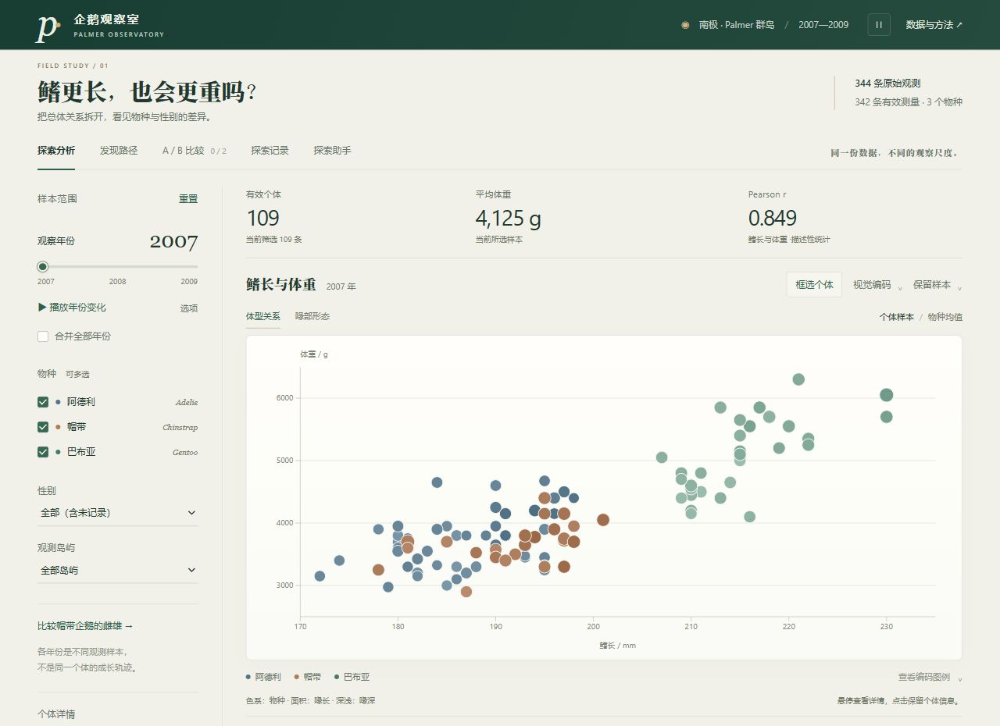

# Palmer 企鹅观察室

围绕一个问题探索 Palmer penguins：鳍长与体重的关系，在不同物种和性别中是否一致？

[](https://dai1107.github.io/Interactive-Visualization/)

点击按钮或预览图即可打开在线网页，无需下载或启动服务。

[](https://dai1107.github.io/Interactive-Visualization/)

## 功能

- **探索分析**：年份、物种、性别和岛屿筛选，体型与喙部视角，面积和深浅编码，按需详情。
- **发现路径**：三个问题入口与五步引导，可继续自由探索或恢复开始前条件。
- **A/B 比较**：保存独立快照，以共享坐标、四指标均值差和样本交并差集比较两组。
- **探索记录**：保存和恢复完整条件及观察，支持 JSON 备份、导入与 Markdown 导出。
- **探索助手**：通过 DeepSeek 解读当前样本；筛选建议先预览，再由使用者应用或撤销。

组合选择支持替换、加选、交集、减选和撤销重做。相关性透镜、分布、年度图与明细共用筛选状态。界面采用固定物种色系和坐标范围，支持窄屏布局、键盘操作与减少动态偏好。

## 本地运行

纯图表只需 Python 3，在仓库根目录运行：

```powershell
python -m http.server 8000 --bind 127.0.0.1
```

打开 [本地网页](http://127.0.0.1:8000/)。源码入口需要 HTTP 服务加载模块和 CSV。

导出可直接打开的单文件 HTML：

```powershell
python scripts/build_offline.py penguins-offline.html
```

离线文件包含图表、D3 和原始数据。LLM 需要联网及允许的网页来源；默认助手后端允许 GitHub Pages，直接打开本机 HTML 时不提供模型连接。

## 验证与构建

测试与 Worker 构建使用 Node.js 22 或以上，不需要安装项目 npm 依赖。

```powershell
npm test
python scripts/audit_penguins.py
node scripts/build_worker.mjs
python scripts/check_site.py https://dai1107.github.io/Interactive-Visualization/
```

当前保留 45 项数据、图形、选择和助手协议测试；数据审计输出 `docs/data-audit.json`。静态资源检查核对 21 项线上文件、模块 MIME 和原始 CSV 哈希。

LLM 后端已部署，拥有者已确认网页真实提问返回回答。自动测试使用明确标记的夹具；云端候选操作应用与撤销尚未单独验收。

## 目录与文档

| 路径 | 用途 |
| --- | --- |
| `index.html`、`assets/` | 当前 D3 网页与交互模块 |
| `api/`、`server/` | 助手请求处理、统计复核和本地调试服务 |
| `scripts/` | 数据审计、离线导出、Worker 构建和线上核对 |
| `tests/` | 数据、D3、组合选择、记录与 LLM 测试 |
| `vendor/` | 本地 D3 7.9.0 及许可证 |
| `EDA_企鹅数据探索/` | 原始 CSV、前期 EDA 报告、图表及复现代码 |

- [设计与统计口径](docs/design.md)
- [GitHub Pages 与 Cloudflare 部署](docs/deployment.md)
- [原始 EDA 报告](EDA_企鹅数据探索/企鹅数据探索报告.md)
- [作业要求原文](<作业 3-交互可视化-2(1).docx>)

作业报告的复核基准为 [1d3daa4](https://github.com/dai1107/Interactive-Visualization/tree/1d3daa4128dfc31f6281b7001de14508fb901b60)；阶段文档和早期实现可在对应提交中查看。

## 数据与引用

原始 CSV 共 344 条观测，2007—2009 年、三个物种和三座岛屿。主图排除鳍长或体重缺失的 2 条，保留 342 条；其中 333 条记录了性别，9 条性别未记录。数据不插补、不生成，编号按原始 CSV 行序生成。

数据来自 [palmerpenguins](https://allisonhorst.github.io/palmerpenguins/)，采用 CC0 许可。Horst AM, Hill AP, Gorman KB (2020), [doi:10.5281/zenodo.3960218](https://doi.org/10.5281/zenodo.3960218)。原始研究：Gorman KB, Williams TD, Fraser WR (2014), [doi:10.1371/journal.pone.0090081](https://doi.org/10.1371/journal.pone.0090081)。D3 使用 BSD 3-Clause 许可，完整文本见 [D3-LICENSE.txt](vendor/D3-LICENSE.txt)。
