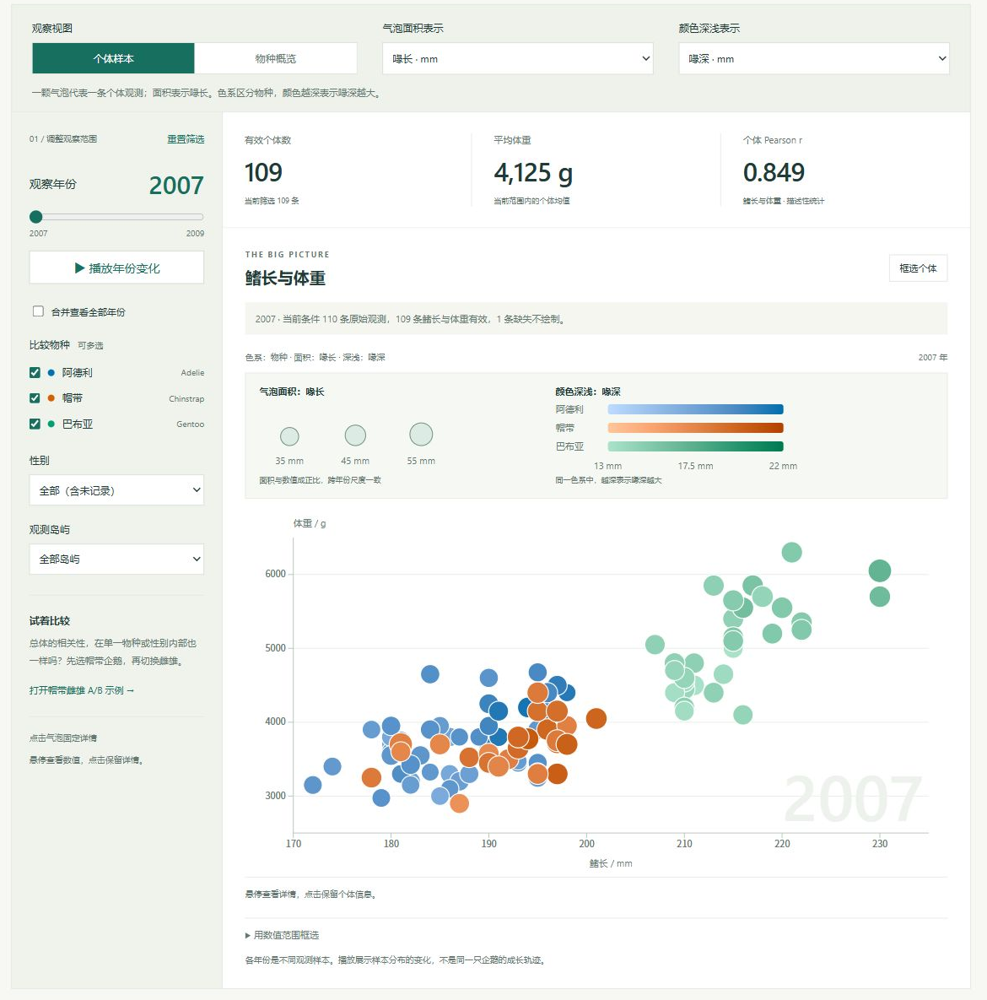

# Palmer 企鹅观察室

## ▶ [点击这里操作交互图表](https://dai1107.github.io/Interactive-Visualization/?v=encoding-20261111b#explorer)

进入本仓库的 GitHub Pages，即可切换年份、播放气泡变化、筛选物种和查看个体数据。也可点击下面的预览图进入。

[](https://dai1107.github.io/Interactive-Visualization/?v=encoding-20261111b#explorer)

> 这张图是静态预览。实际交互请点击上方标题或图片；GitHub 的 `index.html` 文件页用于查看、编辑源码。

研究问题：鳍长与体重的关系在不同物种和性别中是否一致？延续作业 2 的企鹅探索性分析，完成作业 3 的交互网页。

本次版本参照 GDP 与寿命页面的布局，采用左侧筛选、上方统计、右侧主图、下方年度图与明细。主图只保留气泡，取消回归线与均值菱形的叠加。新增真实年份切换和播放、物种均值气泡、气泡面积图例、岛屿筛选。A/B 对比默认收起。

发布地址：[GitHub Pages](https://dai1107.github.io/Interactive-Visualization/)。仓库：[dai1107/Interactive-Visualization](https://github.com/dai1107/Interactive-Visualization)。Pages 从 `main` 分支根目录发布，使用下方资源核验脚本确认线上版本与源码一致。

## 主要交互

1. 默认显示 2007 年的 109 条有效个体。拖动年份切换到 2008 年（114 条）或 2009 年（119 条），也可播放，或合并查看全部年份（342 条）。播放到 2009 年自动停止。
2. 个体样本视图中，位置表示鳍长与体重，色系表示物种，气泡面积表示喙长，可换成喙深或等大点。深浅默认表示喙深，可换为喙长或关闭。气泡整体增大，面积仍与原始数值成正比。面积从零起算，半径按平方根缩放。
3. 物种概览中，每个气泡代表一个物种的均值，面积表示该条件下的样本数。播放年份时，均值位置和面积平滑变化。不同年份是不同样本，不是同一只企鹅的成长轨迹。
4. 筛选物种、性别、岛屿。全部性别包含未记录者；无样本时显示空状态。样本数、平均体重、Pearson r 均由有效个体计算，不把三个物种均值当成三个观测计算相关。
5. 个体视图开启框选后，拖动矩形使统计与明细联动；也可输入数值范围。合并年份，使用鳍长 180—200 mm、体重 3000—4000 g，得到 144 条、均重约 3554.0 g、r≈0.218。切换筛选或年份会清除旧框选。
6. 悬停或键盘聚焦气泡查看详情；点击或按 Enter 固定在侧栏，明细中的编号也可固定详情。当前 CSV 下载保留全部选中个体，不只导出屏幕可见的几行。
7. 独立年度图沿用物种、性别、岛屿条件，比较三个年份的平均体重或平均鳍长，忽略当前年份限制与框选。纵轴按实际均值缩放。
8. 展开 A/B 对比后可保存记录与完整条件（含年份、岛屿、框选），之后操作不改变快照；可恢复条件、下载含组标签的对比 CSV。帽带雌雄示例各 34 条。快照仅保存于当前会话。

## 数据与实现

原始 [penguins.csv](EDA_企鹅数据探索/penguins.csv) 完整保留，不插补、不生成数据。344 条原始记录中，342 条鳍长与体重有效；其中 333 条记录了性别，9 条性别缺失。编号按 CSV 原始行序生成，不能跨年追踪身份。总体 r≈0.871，属于描述性相关，不能推断因果或显著性。

当前页面使用本地固定版本 D3.js 7.9.0，无 CDN、外部字体或后端依赖。入口为 `index.html`，运行模块为 `assets/bubble-app.js`、`assets/bubble-chart.js`、`assets/bubble-model.js`，复用 `assets/data.js` 的 CSV 解析与基础统计。旧版 Vega 模块和测试保留用于历史复核，当前入口不加载。面积与深浅的更新说明见 [气泡面积与深浅编码](docs/09_气泡面积与深浅编码.md)。

## 本地运行与单文件导出

需要 Python 3，无需安装 npm 依赖或构建：

```powershell
python -m http.server 8000 --bind 127.0.0.1
```

打开 http://127.0.0.1:8000/ 。源代码入口需要 HTTP 服务，不能直接双击加载模块与 CSV。

需要可双击、断网使用的版本：

```powershell
python scripts/build_offline.py penguins-offline.html
```

导出的单文件嵌入同一份 CSS、D3、应用和原始 CSV，源数据下载也可离线使用。

## 验证与发布

Node.js 18+，无需第三方测试依赖：

```powershell
node --test tests/*.test.mjs
```

22 项测试包含原始数据哈希、缺失处理、统计与历史模块，以及新增的年份分区、岛屿和性别筛选、物种均值、面积比例、年度图统计口径、框选和快照独立性。浏览器交互验收见 [动态气泡与布局重做](docs/08_动态气泡与布局重做.md)。`tests/browser-smoke.cjs` 对应旧版界面，当前版本不使用该脚本。

GitHub Pages 使用 `main` 分支根目录和 `.nojekyll`，支持项目子路径。后续提交推送后，可核对线上版本：

```powershell
python scripts/check_site.py https://dai1107.github.io/Interactive-Visualization/
```

该脚本核对资源字节、脚本 MIME 和原始 CSV 哈希，不代替真实浏览器验证。

## 项目资料与引用

- [实施清单](作业3实施清单.md)
- [数据核查](docs/02_数据核查.md)
- [本次布局、动态气泡与验收](docs/08_动态气泡与布局重做.md)
- [作业 2 EDA](EDA_企鹅数据探索/企鹅数据探索报告.md)

`docs/01`—`docs/07` 是前期设计和验收记录，其中旧版界面说明以本 README 和 `docs/08` 为准。

数据来自 [palmerpenguins 官方项目](https://allisonhorst.github.io/palmerpenguins/)，采用 CC0 许可。Horst AM, Hill AP, Gorman KB (2020), [doi:10.5281/zenodo.3960218](https://doi.org/10.5281/zenodo.3960218)。原始研究：Gorman KB, Williams TD, Fraser WR (2014), [doi:10.1371/journal.pone.0090081](https://doi.org/10.1371/journal.pone.0090081)。D3 许可随库保存在 `vendor/D3-LICENSE.txt`。
