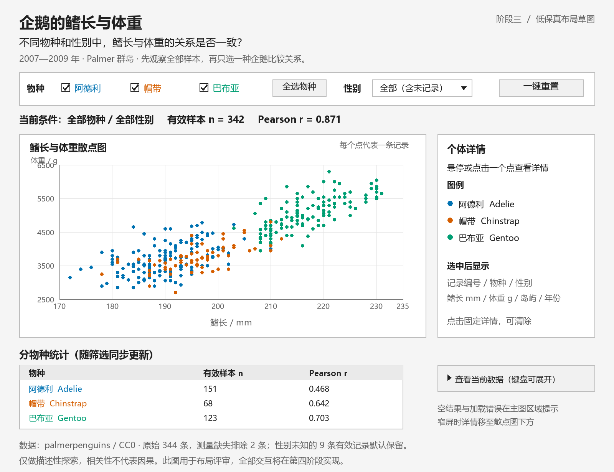

# 企鹅鳍长与体重交互设计

本阶段确定图形编码、页面布局、交互状态和验收行为，供后续开发执行。此处是设计规格，尚未实现网页功能。

## 一 页面布局草图

草图使用真实数据的散点位置和初始统计值，控件与详情位置用于说明布局；草图本身不可交互。可使用 `python scripts/draw_wireframe.py` 重新生成，需 Pillow 与 Windows 微软雅黑字体。

页面从上到下依次为研究问题、数据范围与一句操作提示、筛选区、当前条件与统计、主散点图和详情、分物种统计、来源与局限。桌面端主图与详情并列；窄屏改为主图在前、详情在后，筛选控件换行，避免水平滚动。

首屏提示文案：“先观察全部样本，再只选一种企鹅，比较关系是否改变。”

## 二 视觉编码

| 元素 | 设计 | 原因与约束 |
| --- | --- | --- |
| 图形 | 一条记录一个点的散点图 | 两个连续测量值适合通过位置呈现关系、分群和重叠 |
| 横轴 | 鳍长 mm；线性，固定 170—235 | 覆盖实际 172—231 mm，筛选时不自动缩放，便于比较 |
| 纵轴 | 体重 g；线性，固定 2500—6500 | 覆盖实际 2700—6300 g；散点图不必从零起点，但须明确刻度 |
| 颜色 | Adelie 蓝色 #0072B2；Chinstrap 橙色 #D55E00；Gentoo 绿色 #009E73 | 固定物种对应关系；控件和统计表同时提供文字，详情显示物种，避免只靠颜色解释 |
| 点 | 约 4 px 半径，透明度约 0.65，统一大小 | 减轻重叠；大小不编码第三个变量，避免引入无关维度 |
| 选中记录 | 深色外描边，其他点保持原位 | 能定位详情对应的点，不改变数据含义 |
| 统计 | 当前子集 n、Pearson r，以及按物种的 n、r | 让总体和组内关系可直接比较；r 保留三位小数 |
| 性别 | 控件选择和详情文字 | 首版不叠加形状编码，使物种颜色与空间关系保持清晰 |

坐标尺度随容器宽度重绘，但数值范围不变。主图下方使用紧凑数据表呈现分组统计，不视为已完成多视图协同。若后续加入辅助图形，需补充联动规则。

## 三 方案比较与取舍

| 候选方案 | 优点 | 本次选择或舍弃理由 |
| --- | --- | --- |
| 散点图 + 筛选 + 统计表 | 保留个体关系，能看分群，统计值随筛选变化 | 首版采用，直接服务核心问题，范围可控 |
| 只做体重箱线图 | 擅长比较体重分布 | 不能直接回答鳍长与体重的关系，不能作为主图 |
| 按物种或性别分面 | 减少点群遮挡，便于并排比较 | 多个面板压缩首屏空间；首版用固定坐标筛选和分组统计替代 |
| 散点矩阵与自由切换指标 | 可探索更多身体测量关系 | 使主题扩散、增加说明和状态复杂度，首版不采用 |
| 岛屿地图 | 突出地理背景 | 三个岛屿且物种与岛屿关联，地图难以直接解释核心关系 |
| LLM 自然语言筛选 | 可用自然语言表达条件 | 本项目少量明确筛选已足够；首版不增加 API、凭据及错误处理成本 |

## 四 控件和交互规则

物种为三项复选框，允许多选和全部取消；另提供“全选物种”。性别为单选下拉框，选项为全部、雌性、雄性、未记录。两个维度取交集。

| 用户操作 | 状态与图形变化 | 回答的问题或验收要求 |
| --- | --- | --- |
| 勾选物种 | 立即更新主图、条件摘要、总 n/r 和分物种表 | 总体关系与某物种内部关系是否相同 |
| 切换性别 | 在当前物种范围内更新全部输出；“全部”包含未知性别 | 同一物种不同性别的关系如何变化 |
| 悬停一个点 | 显示临时详情和点描边 | 这个点的物种、测量值及采样背景是什么 |
| 点击或轻触一个点 | 固定详情，显示“已固定”；另选点可替换 | 触屏及需要仔细阅读时可使用 |
| 移开鼠标 | 没有固定记录时清空临时详情；已有固定记录则恢复固定详情 | 详情状态可预测 |
| 清除详情 | 取消固定记录和临时详情 | 恢复默认提示，不改变筛选 |
| 筛选使固定记录不可见 | 清除固定详情并提示“原记录不在当前筛选范围” | 防止保留与当前图形不一致的数据 |
| 全选物种 | 恢复三种物种，保留当前性别条件 | 快速回到跨物种比较 |
| 一键重置 | 三种物种全选，性别为全部，清除临时与固定详情及错误提示 | 回到初始 n=342、r≈0.871 |

所有筛选更新只计算当前数据子集，不重新下载 CSV。图例仅说明颜色，首版不额外绑定点击筛选，避免与复选框产生两套状态。

## 五 初始状态和详情内容

初始物种为全选、性别为全部；无需操作即可显示 342 条有效测量记录、r≈0.871。分物种表为 Adelie n=151/r≈0.468、Chinstrap n=68/r≈0.642、Gentoo n=123/r≈0.703。性别缺失的 9 条有效测量记录计入初始图形；两条鳍长和体重缺失记录不绘制。

默认条件摘要：“物种：全部｜性别：全部｜显示 342 / 342 条有效测量记录；原始 344 条，缺测排除 2 条。”筛选后的分母仍为 342，方便理解当前覆盖范围。

详情显示本地记录编号、物种中英文名称、性别、鳍长 mm、体重 g、岛屿、年份。未选择记录时提示“悬停或点击一个点查看详情”。编号来自原始 CSV 顺序，必须注明它不代表可追踪的个体身份。

## 六 统计与状态处理

设原始数据为 R，有效测量记录为 V，当前物种与性别条件为 F，显示子集 D = V ∩ F。总 n/r 从 D 计算；分物种表将 D 再按 species 划分计算。表中保留三个物种行：未勾选物种显示“未选择”，已勾选但无记录显示 n=0、r=“不可计算”。

Pearson r 使用同一子集的成对有效鳍长与体重计算。n < 3、横轴或纵轴方差为零时不显示数值；n < 10 时额外提示“样本较少，谨慎解释”。此阈值是界面解释提示，不是统计显著性标准。不要把“不可计算”显示为 0。

| 状态 | 页面反馈与恢复方式 |
| --- | --- |
| 加载中 | 显示“正在加载企鹅数据”，禁用依赖数据的筛选控件 |
| 加载失败 | 显示可理解的错误及“重新加载”；不显示旧数据冒充成功，技术细节可保留在控制台 |
| 必需列缺失或无法解析 | 停止绘图并提示数据格式不正确；后续开发中核验字段与有限数值 |
| 没有选择任何物种 | 保留坐标轴，提示“请选择至少一种企鹅”，提供“全选物种”及“重置” |
| 条件组合无结果 | 保留当前条件，n=0，提示“当前条件没有有效记录”，可修改条件或重置 |
| 结果不足以计算 r | 保留有效点，显示 n 和“相关系数不可计算”及原因 |
| 无详情记录 | 显示操作提示；不能保留此前筛选的过期详情 |

桌面键盘用户可 Tab 到复选框、性别菜单、重置及清除详情控件，并看到焦点边框。为不便使用鼠标的用户提供可展开的“查看当前数据”语义化表格，包含与详情相同的字段；表格默认折叠，数据可按原始行序阅读。这保证触屏及键盘用户有获取个体信息的替代途径。

## 七 一条完整的探索路径

1. 初始看见向右上分布的点群和总体 r≈0.871。
2. 只选帽带企鹅，观察 n=68、r≈0.642，且点群的跨度较总体缩小。
3. 性别选雌性，观察 n=34、r≈0.242；再选雄性，观察 n=34、r≈0.665。
4. 点击一点，读取其测量值和采样背景，核对点与轴位置。
5. 点击重置，恢复全部 342 条记录；理解分组后的相关性与总体相关存在差异，结果不支持因果或显著性断言。

## 八 开发时的验收清单

- [ ] 初始图形与数据核查中的 n/r 一致，原始数据文件未改动。
- [ ] T1—T3 都可完成；筛选、图形、统计和详情始终使用同一状态。
- [ ] 全部取消物种、单一物种 + 未知性别等组合可正确显示空结果或小样本。
- [ ] 切换性别和物种时坐标范围、颜色含义与单位保持一致。
- [ ] 固定详情被筛除后自动清除，重置恢复初始状态。
- [ ] 加载失败可重试；窄屏、触屏和键盘操作具有可用路径。
- [ ] 页脚包含来源、有效样本口径和描述性分析局限。

以上项目属于第四阶段以后网页实现的验收要求，本阶段不勾选为已实现。
