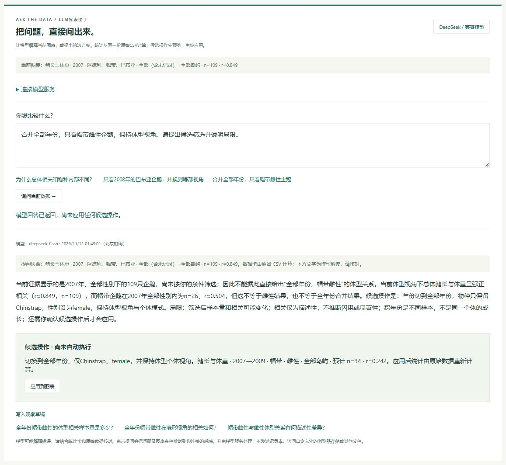

# DeepSeek自然语言探索助手

已实现真实DeepSeek兼容API调用，并在本机完成真实模型和浏览器联动验收。线上GitHub Pages包含助手前端；要让线上访客调用模型，还需要部署后端并配置其地址。GitHub Pages不会执行仓库中的服务端函数。原始企鹅数据、坐标和既有探索功能继续沿用。

## 交互流程

1. 连接自己的助手后端，填写访问口令。DeepSeek API Key只在后端配置，不进入前端源码、浏览器持久存储或Git提交。
2. 提问，例如“为什么总体相关和物种内部不同？”或“合并全部年份，只看帽带雌性企鹅”。
3. 后端从同一份原始CSV重新计算统计快照：当前条件、两种视角的n和r、四项均值、物种内统计与同年其余样本。模型收到问题和这份证据，不接收记录本、其他浏览器存储或本机文件。
4. 模型返回解释、后续问题及可选的完整候选视图。前后端校验字段和范围；后端统计必须与浏览器原始数据计算结果一致。
5. 候选操作显示条件与预计n/r；用户点击后应用，不自动执行代码。可以撤销。条件改变后旧回答仍可读，但其操作和写入草稿按钮禁用，避免错用过期快照。
6. 可将模型解读写入观察草稿，核对后再保存到探索记录本。文字以纯文本显示，标明模型解读需要复核。

## 真实验收

2026-11-12，通过DeepSeek官方`/chat/completions`调用`deepseek-flash`，不是预置规则或测试夹具：

- 服务端真实调用：要求“全部年份、帽带雌性、体型视角”，返回合法候选条件；原始CSV复核n=34、r=0.2421500157。该次用量为1192输入token、295输出token，仅记录用量和模型名，不记录密钥。
- 浏览器真实端到端调用：从2007年109条、r=0.849的当前快照发问；模型返回全部年份帽带雌性候选。按钮应用后主图n=34、r=0.242、sex=female、allYears=true；撤销后恢复109条。
- 真实回答可写入观察草稿。手动改变年份范围后，旧回答的应用与草稿按钮禁用。
- 390px视口无水平溢出，临时视口已重置。最终浏览器错误和警告日志为空。
- 39项Node测试通过，其中8项新增测试覆盖原始数据证据、候选字段/范围、连接地址、兼容接口请求、访问权限、跨域、数据版本、截断/空JSON和上游错误脱敏。自动测试使用明确标记的夹具；它们与上述真实API及浏览器验收分开记录。



这张截图来自本机后端的真实模型调用，不表示线上后端已经部署。未连接时界面明确显示没有调用LLM，不以规则文本、重放结果或测试夹具替代模型回答。

## 本机运行

需要Node.js 22+，无需安装第三方依赖：

1. 将根目录`.env.example`复制为`.env`。
2. 在`.env`填写`DEEPSEEK_API_KEY`与至少16位的随机`LLM_ACCESS_TOKEN`。前者是服务端模型密钥；后者是使用这个后端的独立访问口令。`.env`已被Git忽略，不能提交或加入源码包。
3. 运行：

```powershell
node --env-file=.env server/dev.mjs
```

4. 打开`http://127.0.0.1:8894/`。展开“连接模型服务”，地址填`http://127.0.0.1:8894/api/penguin-llm`，口令填`.env`中的`LLM_ACCESS_TOKEN`，点击连接。
5. 健康检查不调用模型。点击“询问当前数据”才发出模型请求并产生API用量。

本机服务只监听127.0.0.1，限制静态文件路径；不会通过HTTP提供`.env`或Git目录。断开、刷新或关闭页面会清除浏览器内存中的口令，地址可以保存在本浏览器。

## 保留GitHub网址，另部署后端

仓库已准备`api/penguin-llm.mjs`和`vercel.json`，可从同一GitHub仓库导入Vercel部署。无需把密钥写到GitHub文件中。

1. 在自己的Vercel账户导入本仓库。框架选Other，保留仓库配置：构建命令`node scripts/build_vercel.mjs`、静态输出`dist`。后端入口为`api/penguin-llm.mjs`，CSV明确包含在函数部署包。
2. 在平台的环境变量中配置下表。密钥通过后台保存，不通过Git提交。部署前应确认账户、计划和平台额度符合自己的需求；本仓库未替用户创建账户、订购服务或扩大第三方访问权限。

| 环境变量 | 用途 |
| --- | --- |
| `DEEPSEEK_API_KEY` | 服务端DeepSeek密钥，必填 |
| `LLM_ACCESS_TOKEN` | 至少16位访问口令，必填；供授权访客使用，不写公开README |
| `LLM_BASE_URL` | 默认`https://api.deepseek.com`；其他兼容服务填自己的HTTPS根地址，不能包含密钥或查询参数 |
| `LLM_MODEL` | 默认`deepseek-flash`；兼容服务按实际支持的模型填写 |
| `LLM_ALLOWED_ORIGINS` | 逗号分隔允许的网页来源；原GitHub页面为`https://dai1107.github.io`，不是带项目路径的URL |

3. 部署成功后，函数地址为`https://你的后端域名/api/penguin-llm`。先通过界面连接检查，再提问验证。
4. 原GitHub Pages展开连接设置、填写该函数地址即可；也可将公开的函数URL填到`assets/llm-config.js`的`LLM_ENDPOINT`，供页面预填。此文件不能放API Key或访问口令。
5. 如果使用Vercel镜像页面，也把该页面的来源域名加入`LLM_ALLOWED_ORIGINS`。口令校验是访问控制，跨域来源校验不能代替鉴权。

## 实现边界

- 仅支持受校验的现有图表条件，不执行模型返回的JS、SQL或外部工具。响应为纯文本与固定格式JSON。
- 请求最多600字，JSON请求体最多16KB；单次上游45秒超时，输出最多2400token；失败不自动重试，避免重复调用。
- 有效数据版本必须一致。原始统计由确定性代码计算；模型解读仍可能出错，不承诺因果、统计显著性或报告结论正确。
- 密钥、访问口令、授权头及上游原始错误均不记录到返回内容。模型密钥只发送到服务端配置的HTTPS模型根地址，拒绝重定向。
- 后端需实际托管才能让线上访客调用。单文件HTML保留全部图表的离线能力；LLM功能需要联网后端。

依据：[DeepSeek官方首次调用说明](https://api-docs.deepseek.com/)、[JSON Output](https://api-docs.deepseek.com/guides/json_mode/)、[Chat Completions API](https://api-docs.deepseek.com/api/create-chat-completion/)、[Vercel Node.js Functions](https://vercel.com/docs/functions/runtimes/node-js)。模型名与接口在2026-11-12核对；未来可通过环境变量调整，不需要修改前端交互逻辑。
