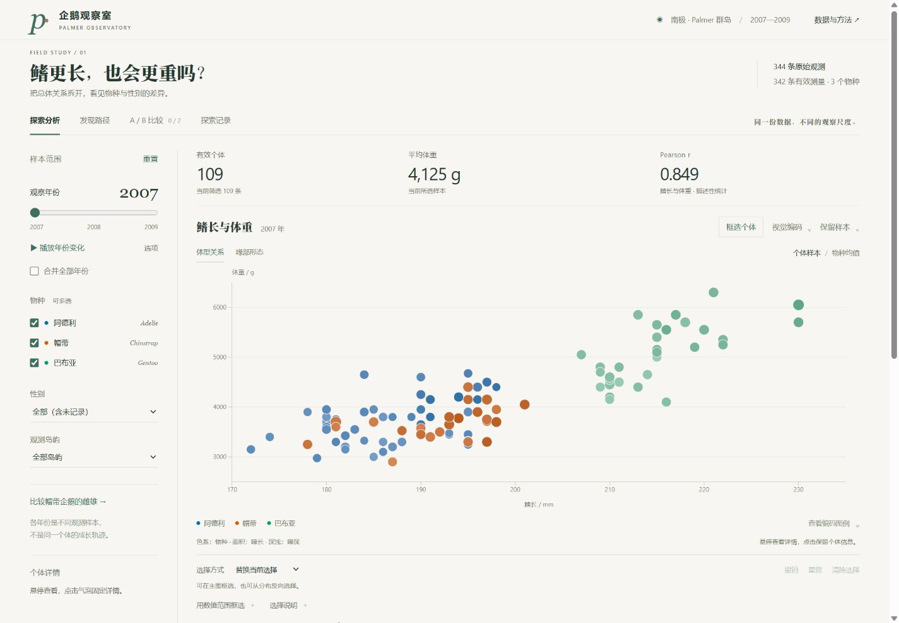

# 工作台布局与视觉重设计

2026 年 11 月 13 日。本版本重新组织信息架构、控件层级与视觉系统，继续使用原始企鹅数据、现有统计和复杂选择功能。

## 四个工作区

探索分析以左侧样本筛选、右侧统计与主图组成固定的分析工作台。相关性透镜、分布与构成、年度变化、个体数据共享下方的分析区域，通过标签切换，始终沿用当前选择。切换分析标签只改变显示区域，不修改样本条件。

发现路径提供三个问题入口和五步引导。引导只在主动使用时显示；手动改变条件后转入自由探索并收起引导条。引导前的状态仍可从发现路径页恢复。局部范围步骤自动打开分布分析，第五步提供直接进入A/B比较的按钮。

A/B比较拥有独立页面，使用共享坐标的两个并置图形。四指标均值差和样本集合关系位于下方。探索页的“保留样本”菜单可直接存A、存B或进入记录，导航中显示已保留组数；恢复条件或查看集合结果会回到探索页。

探索记录采用编辑区与存档区并置的布局。标题、观察输入和保存操作保持在一起，已保存的发现独立排列；导入与导出作为次级工具展开。保存、恢复和删除结果均有明确反馈。

## 视觉层级

页面使用暖白底、墨色文字、青绿强调与细分隔线。标题采用本机宋体或衬线字体，数字与操作文字采用无衬线字体。大面积卡片底色和重复框线被移除，分区主要通过对齐、留白和字重建立。

首屏展示样本筛选、核心统计和主图。面积与深浅编码放入“视觉编码”菜单，完整图例按需展开；组合选择和精确范围仍在主图下方的固定位置。弹出菜单可以通过点击外部或Escape关闭。

主图适度缩小个体气泡，保留面积与原始数值的比例关系。颜色深浅维持同一字段的固定范围，同时降低色彩浓度；年份不再作为大号水印重复叠加。坐标范围、数据单位和跨年比较口径沿用原实现。

## 屏幕与键盘适配

桌面保持筛选与图形并置，较短屏幕适度降低主图高度。手机将筛选折叠为一个入口，统计和主图优先展示；比较页与记录页顺序排列。小字号和辅助文字经过单独调整，主要操作不依赖悬停。

主导航与分析标签支持左右方向键、Home和End；当前标签使用aria-selected和独立tabpanel关联。点击图形、键盘分箱选择、表格明细及恢复条件继续使用原有数据逻辑。

## 验证结果

47项程序测试通过，覆盖原始数据校验、统计、选择集合、快照与记录恢复。气泡测试继续核对面积比例和深浅顺序。

真实浏览器已核对：

- 默认2007年109条，切换分析标签、工作区或视觉编码后保留当前条件。
- 五步引导的144条局部范围，与喙部38—48mm、16—20mm取交后为69条；在3500—4000g分箱减选后为23条。A独有46条、重合23条、并集69条。
- 从A−B回到主图得到46条，保存为探索记录后可以完整恢复。
- 手机直接打开帽带雌雄示例时A/B各34条，查看并集后回到主图显示68条。
- 390px、850px、1280px与1440px检查中未出现文档横向溢出，手机编码菜单保持在视口内。退出引导后不再保留空的引导区域。
- 键盘导航、Escape关闭菜单和面板重新显示后的图形宽度正常；本轮浏览器错误与警告记录为空。

本版本使用本地D3和系统字体。完整离线HTML由同一份源码与原始CSV导出，GitHub Pages发布状态需另行核对。
