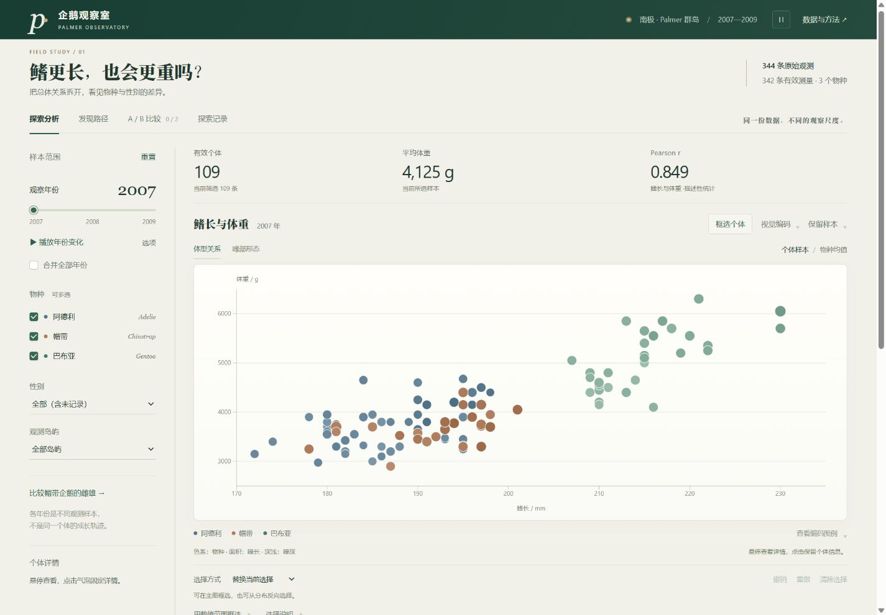

# 配色与动效

2026 年 11 月 13 日。在四工作区布局之上统一色彩、表面、控件和过渡反馈，继续保留原始数据及全部非 LLM 探索功能。

## 色彩与表面

| 用途 | 色彩 |
| --- | --- |
| 页面 / 图表画布 | 暖灰 `#f1f0e9` / 暖白 `#fcfbf7` |
| 正文 / 强调 | 深墨绿 `#22382f` / 松绿 `#2e5f4d` |
| 次级强调 | 铜色 `#a87952` |
| 阿德利 / 帽带 / 巴布亚 | 石板蓝 `#52758b` / 铜橙 `#b27a56` / 松绿 `#477b69` |

深墨绿页眉作为稳定的顶部锚点。主图使用略亮于页面的画布、细边线和极浅投影；辅助区域继续通过留白与分隔线组织。菜单、复选框、年份滑块和主要按钮共用同一组颜色与圆角尺度。宋体标题与无衬线操作文字沿用系统字体，无外部字体请求。

三个物种在所有图形、组成图和图例中使用一致色系。深浅继续由实际测量值按固定范围计算，气泡面积仍与测量值或样本数成比例。选择表达式同时使用线型和文字；A/B 同时使用符号、标签和位置。

## 动效规则

- 主导航及分析标签使用同一条滑动指示线；页面与分析面板只做数像素位移及短暂淡入。
- 主图按原始样本编号保留气泡节点，分别处理进入、退出、位置、面积与颜色变化。退出节点立即移除交互和辅助功能角色，收拢后删除；快速改变条件会中断并接续到最新状态。
- 气泡强调与进出动画分别作用于透明度和填充透明度，避免框选、悬停与过渡互相覆盖。键盘聚焦与固定详情共享轮廓反馈。
- 菜单、提示和控件提供约 150—250ms 的反馈，气泡几何变化最长 480ms。没有持续循环的装饰动画。
- 统计数值立即更新为最终结果，仅附带轻微淡入；不产生任何虚构的中间数值。

页眉动效开关保存本浏览器偏好。关闭后，CSS 过渡、Web Animations 和主图 D3 过渡均停止，图形直接更新。系统 `prefers-reduced-motion` 为 reduce 时自动停用动效并说明原因；用户偏好不会覆盖系统设置。源代码、单文件离线版共用同一实现。

## 验证

47 项现有程序测试通过。原始 CSV 继续逐字节校验，数据与统计口径未修改。

实际浏览器检查包含：

- 2007 年 109 条、2008 年 114 条、2009 年 119 条、合并年份 342 条；快速连续切换后当前节点与统计一致，退出节点完成后清除。
- 局部范围 144 条，与喙部范围取交得到 69 条，再减去 3500—4000g 的体重分箱得到 23 条；联动构成和统计继续沿用最终选集。
- 键盘 Enter 固定个体，重置后固定标记和轮廓同步清除。关闭动效后切换年份直接显示 119 条，导航过渡时长为 0s。
- 离线版帽带雌雄示例各 34 条，查看并集后回到主图得到 68 条；工作区切换、编码、动效开关正常，无浏览器错误或警告。
- 390px 手机、850px 平板、1440px 桌面检查；相关页面无文档横向溢出，手机编码菜单位于视口内。统计注释按完整短语换行。

系统减少动态的分支由代码遵循媒体查询；未更改用户操作系统设置进行测试。项目仍在本地，GitHub Pages 需在同步提交后发布。
